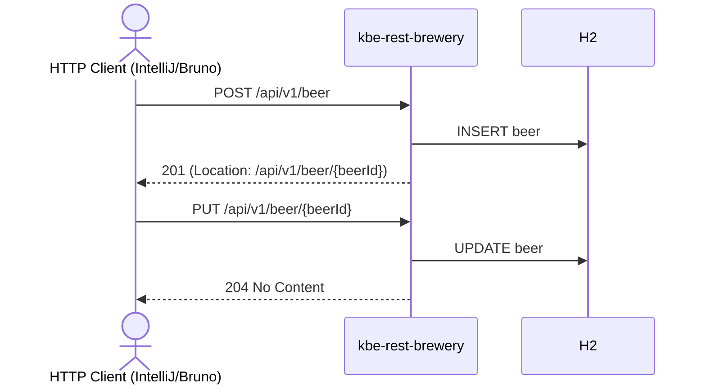

# beer Flow: createBeer → editBeer

Datei: `restRequest/beer-flow-create-edit/beer-flow-create-edit.http`

## Ziel

Ein neues Bier anlegen und dieses anschließend vollständig bearbeiten (PUT).

## Ablauf

## Requests (in dieser Reihenfolge)

1. `createBeer` – legt ein Bier an und speichert `beerId` aus dem `Location`-Header.
2. `editBeer` – vollständiges Update (PUT) dieses Biers.

## Benötigte Globals

|       Global        |         gesetzt von         |            genutzt von            |
|---------------------|-----------------------------|-----------------------------------|
| `beerId`            | `createBeer`                | `editBeer`                        |
| `traceId`, `spanId` | `../scripts/traceparent.js` | alle Requests (Trace-Korrelation) |

## Asserts

- `createBeer` → `201`, `Location`-Header enthält eine ID.
- `editBeer` → `204`.

## Hinweise

- Basis-URL ist `{{application-port}}` (Profil `local` = 8080, `k8s` = 30080).
- `BeerDto` ist `@Validated`: `beerName` und `beerStyle` sind Pflichtfelder, `id` muss beim Anlegen/Update `null` sein.
- `createBeer` liefert keinen Body; die ID wird aus dem `Location`-Header gelesen.
- Das Update ist ein vollständiges PUT und liefert `204 No Content`.

