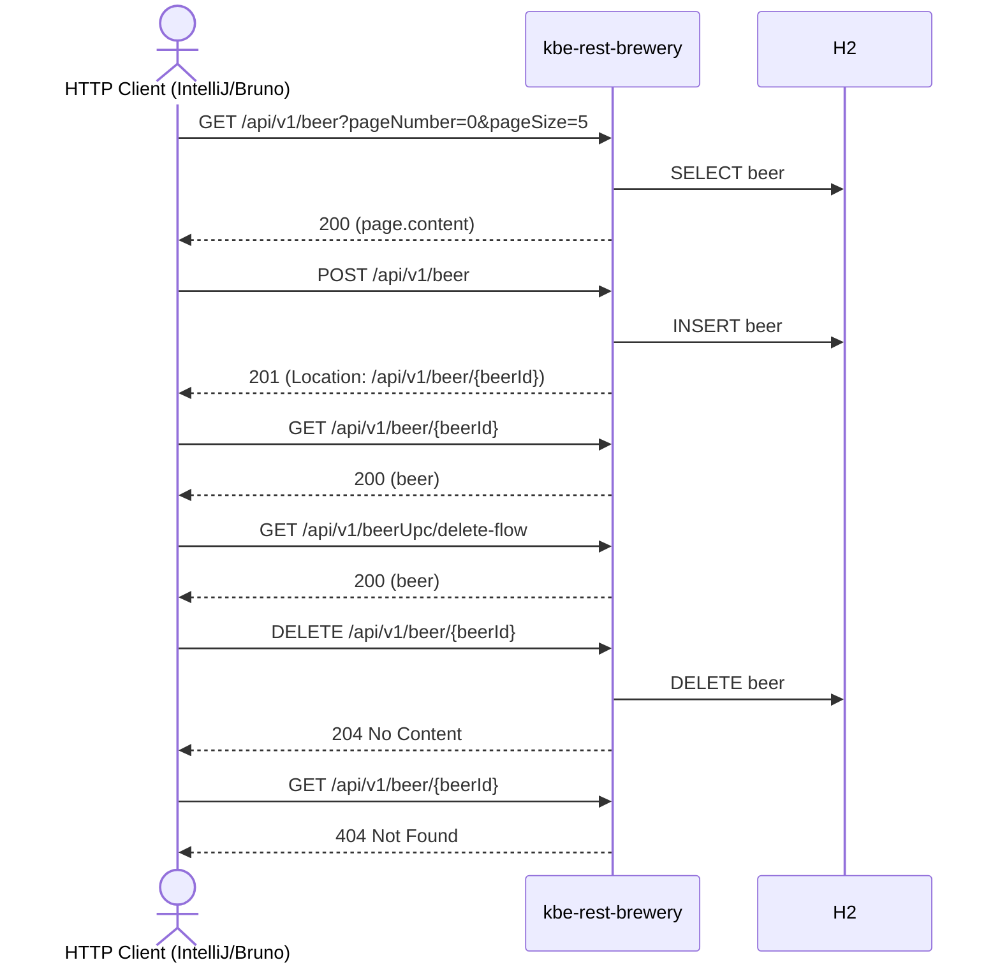

# beer Flow: listBeers → createBeer → getBeerById → getBeerByUpc → deleteBeer

Datei: `restRequest/beer-flow-list-get-delete/beer-flow-list-get-delete.http`

## Ziel

Die Liste abrufen und anschließend ein **eigens angelegtes** Bier per ID und UPC holen und wieder löschen.

## Ablauf

## Requests (in dieser Reihenfolge)

1. `listBeers` – prüft den Listen-Endpunkt (`200`).
2. `createBeer` – legt ein dediziertes Bier für den Delete-Teil an und speichert `beerId`.
3. `getBeerById` – holt das Bier per `beerId`.
4. `getBeerByUpc` – holt dasselbe Bier über seine UPC.
5. `deleteBeer` – löscht genau dieses selbst angelegte Bier per `beerId`.
6. `getBeerById` – prüft, dass das Bier danach `404` liefert.

## Benötigte Globals

|       Global        |         gesetzt von         |            genutzt von            |
|---------------------|-----------------------------|-----------------------------------|
| `beerId`            | `createBeer`                | `getBeerById`, `deleteBeer`       |
| `traceId`, `spanId` | `../scripts/traceparent.js` | alle Requests (Trace-Korrelation) |

## Asserts

- `listBeers` → `200`.
- `createBeer` → `201` mit ID im `Location`-Header.
- `getBeerById` → `200`, `id` entspricht der `{{beerId}}`.
- `getBeerByUpc` → `200`, `upc` entspricht `delete-flow`.
- `deleteBeer` → `204`.
- `getBeerById` nach dem Delete → `404`.

## Hinweise

- Basis-URL ist `{{application-port}}` (Profil `local` = 8080, `k8s` = 30080).
- `listBeers` liefert eine Page; das erste Element liegt unter `response.body.content[0]`.
- `NotFoundException` ist mit `@ResponseStatus(HttpStatus.NOT_FOUND)` annotiert.

