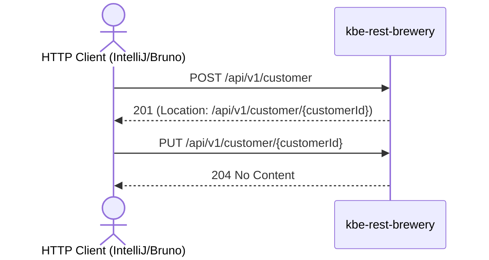

# customer Flow: createCustomer → editCustomer

Datei: `restRequest/customer-flow-create-edit/customer-flow-create-edit.http`

## Ziel

Einen neuen Kunden anlegen und diesen anschließend vollständig bearbeiten (PUT).

## Ablauf

## Requests (in dieser Reihenfolge)

1. `createCustomer` – legt einen Kunden an und speichert `customerId` aus dem `Location`-Header.
2. `editCustomer` – vollständiges Update (PUT) dieses Kunden.

## Benötigte Globals

|       Global        |         gesetzt von         |            genutzt von            |
|---------------------|-----------------------------|-----------------------------------|
| `customerId`        | `createCustomer`            | `editCustomer`                    |
| `traceId`, `spanId` | `../scripts/traceparent.js` | alle Requests (Trace-Korrelation) |

## Asserts

- `createCustomer` → `201`, `Location`-Header enthält eine ID.
- `editCustomer` → `204`.

## Hinweise

- Basis-URL ist `{{application-port}}` (Profil `local` = 8080, `k8s` = 30080).
- `CustomerDto` hat das Feld `name` (`@NotBlank`, 3–100 Zeichen).
- `createCustomer` liefert keinen Body; die ID wird aus dem `Location`-Header gelesen.
- Der `CustomerServiceImpl` ist aktuell ein Stub: Das Update ist ein No-op, liefert aber `204`.

