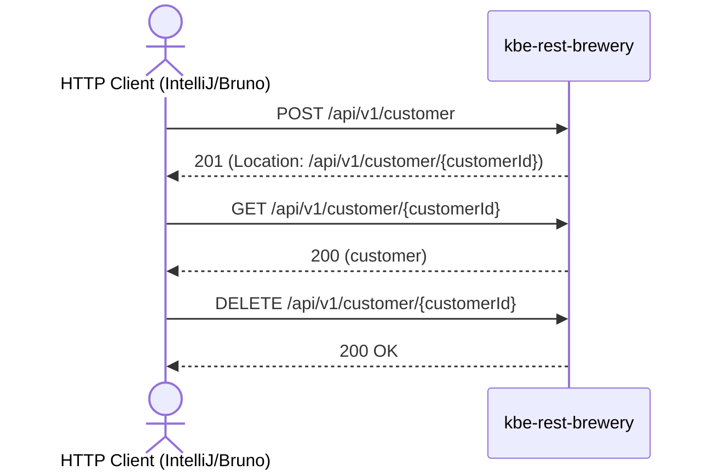

# customer Flow: createCustomer → getCustomerById → deleteCustomer

Datei: `restRequest/customer-flow-create-get-delete/customer-flow-create-get-delete.http`

## Ziel

Einen Kunden anlegen, per ID abrufen und wieder löschen.

## Ablauf

## Requests (in dieser Reihenfolge)

1. `createCustomer` – legt einen Kunden an und speichert `customerId` aus dem `Location`-Header.
2. `getCustomerById` – holt den Kunden per `customerId`.
3. `deleteCustomer` – löscht den Kunden per `customerId`.

## Benötigte Globals

|       Global        |         gesetzt von         |             genutzt von             |
|---------------------|-----------------------------|-------------------------------------|
| `customerId`        | `createCustomer`            | `getCustomerById`, `deleteCustomer` |
| `traceId`, `spanId` | `../scripts/traceparent.js` | alle Requests (Trace-Korrelation)   |

## Asserts

- `createCustomer` → `201` mit ID im `Location`-Header.
- `getCustomerById` → `200` mit Body.
- `deleteCustomer` → `200`.

## Hinweise

- Basis-URL ist `{{application-port}}` (Profil `local` = 8080, `k8s` = 30080).
- Der `CustomerServiceImpl` ist aktuell ein Stub: `getCustomerById` liefert einen zufälligen Kunden
  (`Joe Buck`) und `deleteById` ist ein No-op. Deshalb wird hier **keine** ID-Gleichheit und kein `404`
  nach dem Delete geprüft.

